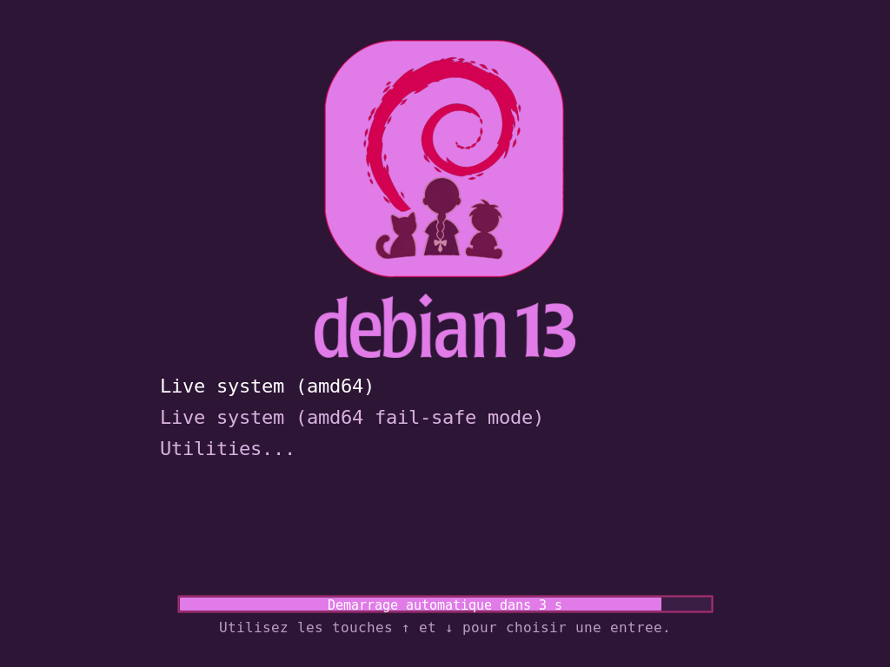

# Kiddux

Système GNU/Linux minimaliste basé sur Debian 13 « trixie », pensé pour les
enfants : simplicité, autonomie et initiation à l'informatique.

Télécharger [ici](https://github.com/ElenaFri/debian-minimal-kids/releases/latest)
(ISO ~1,46 Gio, vérifiable avec `SHA256SUMS.txt`)




Applications : Firefox ESR, LibreOffice (texte, présentation), Gedit, Thunar,
VLC, Drawing, Galculator, qpdfview.
Jeux : Extreme Tux Racer, Luanti, Atomix, 2048, Swell Foop.

## Compatibilité

- PC 64 bits (amd64), BIOS ou UEFI avec Secure Boot ; ~2 Gio de RAM.
- Démarrage clé USB (image hybride) ou DVD. Essayer le mode live avant
  d'installer ; installation permanente via l'icône « Installer Kiddux » (Calamares).
- Non pris en charge : 32 bits, ARM (Raspberry Pi, Mac Apple Silicon) ; le
  matériel très récent et les anciennes puces WiFi Broadcom (b43) peuvent
  manquer de pilote.
- Test sans risque : machine virtuelle (voir `run-qemu.sh`).

## Construire

`live-build` est un outil **Debian** : la construction se fait sur Debian/Ubuntu/
LMDE, ou dans un conteneur/VM Debian si l'hôte est d'une autre famille (openSUSE,
Fedora, Arch...).

### Sur Debian/Ubuntu

```bash
sudo apt install live-build debootstrap
./clean.sh          # (optionnel) repartir de zéro ; à lancer AVANT le build
./build.sh          
./run-qemu.sh --uefi # tester (voir « Tester dans QEMU »)
```

### Depuis un hôte non-Debian (openSUSE, Fedora...) — conteneur Debian

Le build réclame les droits root et le montage de pseudo-systèmes de fichiers,
d'où `--privileged`. Le dossier du projet est monté dans le conteneur, donc
l'ISO produite apparaît directement sur l'hôte.

```bash
# openSUSE : sudo zypper install podman    (ou docker)
# Rootful (sudo podman) recommandé : lb build monte proc/sys et des loop devices.
sudo podman run --rm -it --privileged -v "$PWD":/work -w /work debian:trixie bash
# --- dans le conteneur ---
apt update && apt install -y live-build debootstrap
./clean.sh && ./build.sh
exit
```

L'ISO produite appartient à root (build rootful) : au besoin,
`sudo chown $USER kiddux-amd64.hybrid.iso`. Puis, de retour sur
l'hôte, tester avec QEMU (`./run-qemu.sh --uefi`). Ne pas lancer `./clean.sh`
entre le build et le test : `lb clean` supprime les artefacts, **ISO comprise**.

Résultat : `kiddux-amd64.hybrid.iso`. Au démarrage du live, XFCE
en session automatique (`lisa` sur `kids-pc`), en français.

## Tester dans QEMU

Le son n'est pas émulé par défaut ; le script ajoute une carte Intel HDA reliée
à l'audio de l'hôte :

```bash
./run-qemu.sh              # live avec le son (amorçage BIOS / isolinux)
./run-qemu.sh --uefi       # amorçage UEFI : affiche le thème GRUB « kids »
./run-qemu.sh --uefi --install     # + disque de 20 Go pour tester l'installation
./run-qemu.sh --uefi --installed   # démarre ensuite le système installé (sans CD)
```

**Tester le système installé :** installer avec `--uefi --install`, puis
fermer la VM une fois Calamares terminé et lancer `--uefi --installed`. En UEFI,
l'installateur enregistre l'entrée de démarrage dans la mémoire NVRAM du
firmware ; le script la garde dans `kids-test-ovmf-vars.fd` (réinitialisée à
chaque nouvelle `--install`). Sans elle, OVMF ne sait pas amorcer le disque et
GRUB tombe sur son invite de commande (`grub>`). Utiliser les mêmes options
(`--uefi` ou non) pour l'installation et pour le démarrage.

Par défaut QEMU amorce en BIOS (menu isolinux). Pour voir le menu **GRUB**
thématisé, il faut amorcer en UEFI : `--uefi` branche le firmware OVMF et copie
les variables NVRAM dans un fichier jetable `kids-ovmf-vars.fd`. Installer OVMF
selon la distribution :

```bash
sudo apt install qemu-system-x86 ovmf        # Debian/Ubuntu
sudo zypper install qemu-x86 qemu-ovmf-x86_64 # openSUSE
sudo dnf install qemu-system-x86 edk2-ovmf    # Fedora
```

Commande équivalente, sur une seule ligne :

```bash
qemu-system-x86_64 -enable-kvm -m 2048 -smp 2 -cdrom kiddux-amd64.hybrid.iso -boot d -audiodev pipewire,id=snd0 -device ich9-intel-hda -device hda-duplex,audiodev=snd0
```

### Le son dans QEMU (openSUSE : paquet à installer)

Sur certaines distributions, les backends audio de QEMU sont des **paquets
séparés**. Sans eux, la liste donnée par `qemu-system-x86_64 -audiodev help` se
réduit à `none`, `spice` et `wav`, et **QEMU plante (erreur de segmentation)**
des qu'on lui demande `-audiodev pipewire` ou `pa`, sans message explicite.

```bash
sudo zypper install qemu-audio-pipewire   # openSUSE, session PipeWire
sudo zypper install qemu-audio-pa         # openSUSE, session PulseAudio
sudo apt install qemu-system-x86          # Debian/Ubuntu : backends inclus
```

`run-qemu.sh` lit cette liste et choisit lui-même `pipewire`, puis `pa` en
repli. S'il n'en trouve aucun, il avertit et démarre **sans son** au lieu de
planter.

### Dépannage

| Symptôme | Cause probable | Remède |
|---|---|---|
| `Erreur de segmentation` au lancement | Backend audio absent (voir ci-dessus) | Installer `qemu-audio-*`, ou `--no-audio` |
| Pas de son dans la VM | Aucun backend audio à l'installation de QEMU | Idem ; vérifier `qemu-system-x86_64 -audiodev help` |
| `Display 'sdl' is not available` | SDL non compilé dans QEMU | Utiliser `gtk` (défaut), ou `--display=vnc=:0` |
| `Firmware UEFI (OVMF) introuvable` | OVMF non installé | Voir plus haut |
| Très lent, avertissement `/dev/kvm inaccessible` | KVM indisponible | Activer la virtualisation (BIOS), ajouter l'utilisateur au groupe `kvm` ; sinon `--no-kvm` |

Options de dépannage de `run-qemu.sh`, combinables avec les autres :

```bash
./run-qemu.sh --uefi --no-audio          # sans carte son
./run-qemu.sh --uefi --display=vnc=:0    # sans fenêtre : client VNC sur localhost:5900
./run-qemu.sh --uefi --no-kvm            # émulation pure (lent)
```

## Le bureau

Toute la configuration vit dans `etc/skel/.config/` (via
`config/includes.chroot_after_packages/`), identique sur le live et le système
installé.

- Panneau du bas semi-transparent, texte blanc forcé (`gtk.css`) : bouton Menu
  (globe violet), bureaux, fenêtres, notifications et horloge « 7 novembre
  2026, 22h 29 » épinglées à droite.
- Dock vertical à gauche : Firefox, Gedit, Dessin, VLC, Thunar.
- Thème Yaru-magenta (GTK, icônes, bordures), pointeur ComixCursors-Orange,
  bureau épuré (seule l'icône « Installer Kiddux » sur le live).
- Fond d'écran « chat endormi à la bougie » en mode zoom : remplit l'écran à
  toute résolution, sans déformation.
- Menus d'amorçage « kids » (UEFI **et** BIOS) : même marque que le splash (logo
  sur tuile magenta + « debian 13 ») sur fond aubergine, entrées magenta, en
  remplacement des menus standard de Debian (GRUB cyan/bleu en UEFI, isolinux
  bleu/gris en BIOS). Le menu GRUB (UEFI) ajoute un compte à rebours assorti et
  s'adapte à toute résolution (image jamais déformée) ; le menu isolinux (BIOS)
  est un fond 640x480.
- Splash Plymouth « kids » : icône sur tuile magenta, « debian 13 » en
  typographie Debian d'origine, adapté à toute résolution.
- Thunar en vue liste ; correcteur orthographique français actif partout.
- Menu de démarrage du **système installé** : même thème GRUB, déclaré par
  `GRUB_THEME` / `GRUB_TERMINAL_OUTPUT=gfxterm` dans `etc/default/grub` et
  fourni par `usr/share/grub/themes/kiddux/` (copie de `live-theme/theme.txt`,
  seul le chemin de l'image diffère : **garder les deux synchronisés**). Sans
  `GRUB_THEME`, `update-grub` génère le menu Debian standard cyan sur bleu.
  Le hook `0560-grub-quiet-boot` passe `quiet_boot` à 1 dans `/etc/grub.d/10_linux`
  pour supprimer les messages « Loading Linux… » qui, sinon, feraient clignoter
  l'écran texte Debian entre le menu GRUB et Plymouth. `GRUB_BACKGROUND`
  (aplat aubergine `background.png`) remplace le fond de terminal bleu que
  `05_debian_theme` hérite de desktop-base, visible lui aussi un instant au
  chargement du noyau.
- Démarrage sans clignotement ni écran noir : `GRUB_GFXPAYLOAD_LINUX=keep`
  (installé) et `gfxpayload=keep` conservé dans le `config.cfg` du live — ce
  réglage transmet le framebuffer graphique de GRUB au noyau ; sans lui, GRUB
  repasse le firmware en mode TEXTE au chargement du noyau : rectangle noir
  couvrant le milieu de l'écran juste après le compte à rebours du menu.
  `etc/initramfs-tools/modules` charge en outre le pilote d'affichage
  (DRM/KMS) dès l'initramfs — `bochs`/`virtio-gpu`/`qxl`/`vmwgfx` pour les VM,
  `i915`/`amdgpu`/`radeon`/`nouveau` pour le matériel réel (seul celui du GPU
  présent se charge) : le vrai pilote prend la main directement sur ce
  framebuffer, l'enchaînement GRUB → Plymouth est sans rupture.
- Icône « Installer Kiddux » : posée dans `~/Bureau` par
  `usr/bin/add-calamares-desktop-icon`, qui **remplace** le script de
  `calamares-settings-debian`. L'original déclarait le lanceur « de confiance »
  avec le chemin codé en dur `~/Desktop/` alors que le fichier est dans
  `~/Bureau/` : XFCE affichait au clic l'alerte « lanceur dans un emplacement non
  sécurisé ». Le lanceur doit être exécutable **et** porter les métadonnées GIO
  `metadata::trusted` et `metadata::xfce-exe-checksum` (nécessite `gvfs`).

Config XFCE : `xfce4-panel.xml` (panneaux, lanceurs dans `panel/launcher-<id>/`),
`xsettings.xml` (thème), `xfwm4.xml` (bordures, compositeur), `xfce4-desktop.xml`
(bureau). Le fond est posé par `kids-set-wallpaper` (autostart), xfdesktop 4.20
le rangeant sous une clé liée au connecteur du moniteur.

## Firefox


Configuré par `policies.json` (politiques) et `distribution.ini` (marque-pages).

- Marque-pages sur la barre personnelle : dossiers Vidéos (YouTube Kids, Disney+) et
  École (Khan Academy, Lumni, Scratch, 1jour1actu), Wikipédia en direct. Page
  d'accueil : Lumni.
- Moteur : Qwant Junior (verrouillé). Assistant IA : Le Chat Mistral.
- Thème Alpenglow appliqué au 1er lancement (AutoConfig `kids.cfg`).
- Allégé : télémétrie, études, comptes, mises à jour et navigation privée
  désactivés ; pas de page de bienvenue.

## Contrôle parental

1. DNS familial : un dnsmasq local force SafeSearch et le « Mode restreint »
   YouTube (commentaires et chat en direct masqués), puis transfère à OpenDNS
   FamilyShield (`99-kids-dns.conf`, `00-safe-search.conf`) ; DNS du DHCP
   ignorés, pas de contournement.
2. Firefox verrouillé : réseaux sociaux et sites de chat avec inconnus bloqués
   (`WebsiteFilter`), ajout d'extensions interdit, DoH et `about:config`
   désactivés, navigation privée coupée (historique consultable).
3. Couvre-feu : veille répétée de 21h30 à 7h00 (`kids-bedtime.*`, hook 0510).
   Réveiller la machine pendant cette plage la rendort dans la minute, la
   rendant inutilisable ; l'écran se verrouille à chaque réveil.
4. Comptes (système installé) : l'enfant a un compte sans droits
   d'administration (hors du groupe `sudo`) ; un mot de passe root distinct,
   choisi par le parent à l'installation, sert à administrer. L'enfant ne peut
   donc pas lever les protections ci-dessus. Le live n'est pas concerné.

Régler la plage : lignes `OnCalendar` du timer, puis `systemctl daemon-reload &&
systemctl restart kids-bedtime.timer`. Désactiver : `systemctl disable --now
kids-bedtime.timer`. Sur le système installé, lancer ces commandes en root
(`su -`, mot de passe du parent) ; sur le live, les préfixer de `sudo`. Le
couvre-feu est aussi actif sur le live : pour tester le soir, désactive-le
d'abord.

## Optimisations

- zram (zstd, 50 % RAM) + earlyoom, `vm.swappiness = 100` ; ModemManager et
  NM-wait-online masqués (hook 0510).
- Squashfs zstd niveau 22, menu GRUB UEFI à 3 s (hook 0520), `GRUB_TIMEOUT = 1`
  une fois installé.
- ISO allégée (hook 0540) : agent polkit léger (lxpolkit) sans la chaîne
  OpenCV/GDAL, PDF via qpdfview au lieu d'atril/yelp (pas de WebKitGTK),
  variantes de thèmes/curseurs et traductions superflues purgées, caches
  apt-file/xapian/plocate non construits.

## Structure du projet

| Chemin | Rôle |
|--------|------|
| `auto/config` | Options `lb config` figées |
| `config/package-lists/*.list.chroot` | Paquets : live, locale FR, bureau, applications, jeux, installateur Calamares |
| `config/includes.chroot_after_packages/etc/calamares/` | Branding Kiddux et réglages de l'installateur Calamares |
| `config/hooks/normal/0510-kids-performance.hook.chroot` | zram, earlyoom, couvre-feu ; services inutiles masqués |
| `config/hooks/normal/0520-grub-timeout.binary` | Menu GRUB UEFI : 3 s (pilote le compte à rebours du thème) |
| `config/bootloaders/grub-pc/` | Thème graphique du menu GRUB UEFI (`splash.png` + `live-theme/theme.txt`), aux couleurs Kiddux |
| `config/bootloaders/syslinux_common/` | Thème du menu isolinux BIOS (`splash.png` 640x480 + `stdmenu.cfg`), aux couleurs Kiddux |
| `config/hooks/normal/0530-dconf-defaults.hook.chroot` | Compile les défauts dconf |
| `config/hooks/normal/0540-kids-slim.hook.chroot` | Allège l'image (agent polkit léger, thèmes/curseurs et traductions superflus) |
| `config/hooks/normal/0550-plymouth-theme.hook.chroot` | Embarque le thème Plymouth dans l'initramfs |
| `config/includes.chroot_after_packages/` | DNS, politiques/marque-pages/thème Firefox, Plymouth, dconf, skel XFCE, fond d'écran |
| `config/includes.chroot_after_packages/usr/share/grub/themes/kiddux/` | Thème GRUB du système installé (le live utilise `config/bootloaders/`) |
| `config/hooks/normal/0560-grub-quiet-boot.hook.chroot` | Supprime le flash « Loading Linux… » du GRUB installé |
| `config/includes.chroot_after_packages/etc/initramfs-tools/modules` | KMS précoce : démarrage net, sans changement de résolution |
| `config/hooks/normal/0525-grub-live-video.binary` | GRUB du live : gfxmode haute résolution, `keep` conservé, efi_gop seul |
| `build.sh` / `clean.sh` / `run-qemu.sh` | Scripts pratiques (build, nettoyage, test QEMU avec son) |

## Réglages par défaut

| Paramètre | Valeur |
|-----------|--------|
| Langue / clavier | `fr_FR.UTF-8` / `fr` (AZERTY) |
| Fuseau | `Europe/Paris` |
| Utilisateur / machine | `lisa` / `kids-pc` |

Définis dans `auto/config`. Installation sur disque via Calamares (icône
« Installer Kiddux » sur le bureau du live) ; le système installé hérite du
français, du clavier AZERTY et du splash Plymouth.
